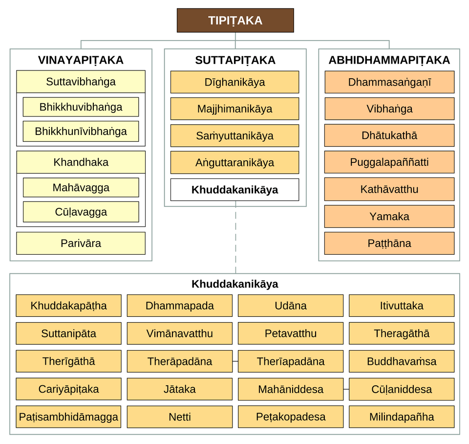

## Pali Canon
### Online Suttas

> - [Reading Faithfully](https://readingfaithfully.org/) 
> *comes with excellent study guides, various free PDFs for Pali Canon texts and daily sutta feature*
> - [SuttaCentral](https://suttacentral.net/)
> *has most texts translated to various world languages along with Pali word lookup and line-by-line comparison.*
> - [Dharmatalks](https://dharmatalks.org/)
> *along with Thanissaro Bhikkhu's other works, it has translated Suttas with contextual information as addendums*

### Free PDFs

*(private MEGA links)*

> - [AN selections](https://mega.nz/file/OiQxDToT#QyHIkOxrNurnJO6PpGivQ7d8tDlV15oruqseeFrOnp8)
> 
> - [Anguttara Nikaya by Bhikkhu Sujato](https://mega.nz/file/7vJxjTjb#SawExxJMM-OKnDx3AVD5gpuaO77YSC3BlafDzi0SEB8)
> 
> - [Dhammapada by Dhammarakkhita](https://mega.nz/file/OihDRDqJ#9loB5-AbbjL7K00FOi2Wx75ahpgJW6sAdvV1ZFCrzYQ)
> 
> - [Dhammapada by Narada Mahathera](https://mega.nz/file/LvRCBSza#uBqHLWi96UXMXisxMUqtPHsXwXJRKSGIaCY0uf-Zkxc)
> 
> - [Digha Nikaya by Bhikkhu Sujato](https://mega.nz/file/2j5AmSgB#Nn9EFl5R7Ur_uWSS977w337iGQhbOSjlsOOngMyzB8w)
> 
> - [Majjhima Nikaya by Bhikkhu Sujato](https://mega.nz/file/fv4HEJZT#SXnaw9wLuPJffA0MLF6uUrMQHxUP13DElIVW5-tVjco)
> 
> - [MN Selections](https://mega.nz/file/WzhT3JyC#8L80oAY1fuppEdNzvU_lehrdtzCgHaAG3VodIGxGXsQ)
> 
> - [Samyutta Nikaya by Bhikkhu Sujato](https://mega.nz/file/izhHhKQY#a-BpVlhVDtruZPcqw10kDrAMzFooHq0nnKhZTwySKeI)
> 
> - [SN Selections](https://mega.nz/file/66gXBQCS#Kj12vMZx2xnzv6J3dnK-n4SITJwIGM80zlTQWxhuzaU)
> 
> - [Sutta Nipata by Bhikkhu Sujato](https://mega.nz/file/riQ1RBAS#wq5f1xYu9Jx9QsQ2IXCaceTlLwP6PhHsBOboic22X0o)
> 
> - [Thera-Therigatha](https://mega.nz/file/6rRVSDib#ksNrdKIurW05d4TwfN2SOXsZFAKIG2s1nyW5mDX4KXo)

### How the Pali Canon is organised

{ align=left, width="500" }
